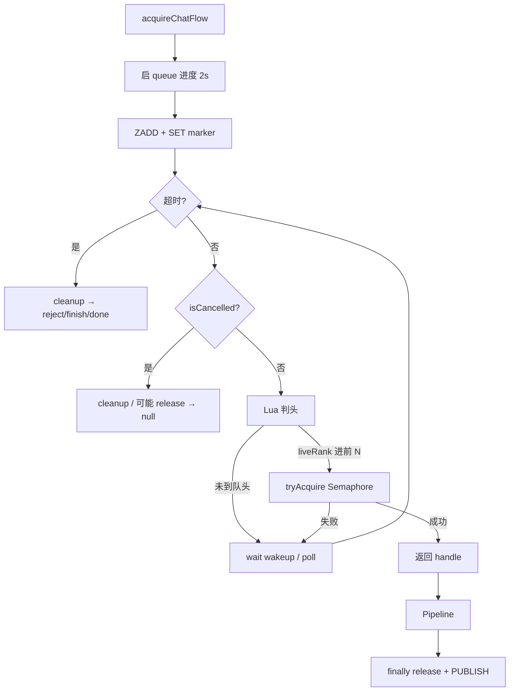

# 14. Chat 排队限流方案

> 对应代码：`chat/chat.service.ts`（`acquireChatFlow`）、`chat/ratelimit/chat-queue.limiter.ts`、`fair-distributed-rate-limiter.ts`、`lua-script.loader.ts`、`poll-notifier.ts`、`config/ratelimit.config.ts`  
> 入口与 Pipeline：[`9`](./9%20在线Chat%20Pipeline与RAG检索.md) · SSE 事件：[`13`](./13%20Chat%20SSE流式推送方案.md)

`ChatService.streamChat` 在 SSE 已建好、用户消息已落库之后、跑 Pipeline 之前调用：

```ts
const handle = await this.queueLimiter.acquireChatFlow({
  sender,
  taskId,
  isCancelled: () => this.taskManager.isCancelled(taskId),
  onRejected: () => this.taskManager.unregister(taskId),
})
```

这一步是：**抢一把全局并发槽**。抢不到就排队 / 拒绝；抢到了才允许改写、检索、调 LLM。

---

## 0. 在整条链里的位置

```text
create SSE + meta
  → append 用户消息
  → handler.init（注册取消）
  → acquireChatFlow(...)     ← 本笔记
       成功 → pipeline.execute → finally release
       失败/取消 → 已推 SSE 收尾，不进 Pipeline
```

传入四个东西：

| 参数 | 作用 |
| --- | --- |
| `sender` | 排队中推 `queue`；超时推 `reject→finish→done` |
| `taskId` | 与取消体系对齐；拒绝时 `unregister` |
| `isCancelled` | 排队循环里查 `StreamTaskManager`，用户 cancel 可立刻退出 |
| `onRejected` | 超时后注销任务，避免 TaskManager 泄漏 |

---

## 1. 两层职责

```text
ChatQueueLimiter                 —— 对前端：SSE 语义
  └─ FairDistributedRateLimiter  —— 对集群：公平准入
        ├─ Redis ZSET 排队
        ├─ entry marker（防僵尸）
        ├─ Lua 原子判头
        ├─ redis-semaphore 信号量（真正限并发）
        └─ Pub/Sub + PollNotifier（防惊群唤醒）
```

**ChatQueueLimiter**：把「拿不到槽」翻译成用户能懂的事件。  
**FairDistributedRateLimiter**：跨 Nest 实例、跨进程共享的「最多 N 路同时推理」。

默认配置（`ratelimit.config.ts`）：

| 项 | 默认 | 含义 |
| --- | --- | --- |
| `maxConcurrent` | 10 | 全局同时最多 10 个 chat 在跑 Pipeline/LLM |
| `maxWaitSeconds` | 15 | 排队最多等 15s，超时 reject |
| `leaseSeconds` | 30 | permit 租约；持有期间自动续期 |
| `pollIntervalMs` | 200 | 没被 Pub/Sub 叫醒时的兜底轮询 |
| `slack` | 16 | Lua 扫队头窗口冗余，顺带清僵尸 |

Redis Key：

| Key | 用途 |
| --- | --- |
| `ragent:ratelimit:chat:queue` | ZSET 主队列，score=入队时间戳 |
| `ragent:ratelimit:chat:marker:{requestId}` | 存活证明，TTL=`lease*2` |
| `ragent:ratelimit:chat:permit` | redis-semaphore 信号量 |
| `ragent:ratelimit:chat:permit_changed` | Pub/Sub：有人 release 时广播 |

---

## 2. 排队流程

### 2.1 `acquireChatFlow`

```text
1. 雪花 requestId（排队身份，≠ taskId）
2. 每 2s：queryRank → SSE event: queue { rank, estimatedWaitSeconds }
3. await limiter.acquire(requestId, maxWaitMs, isCancelled)
4. 停进度推送
5. 分支：
   - 已取消 → 若误拿了 permit 则 release → return null
   - ok=false → reject → finish(null) → done → close → onRejected → null
   - ok=true  → return { requestId, release }
```

`estimateWaitSeconds` 很粗：`ceil(rank / maxConcurrent) * 3` 秒，只给人看进度感。

### 2.2 `FairDistributedRateLimiter.acquire`

```text
SET marker:{requestId}  TTL=lease*2     // 活着证明
ZADD queue  score=now  member=requestId // FIFO

while 未超时:
  if isCancelled → cleanup → cancelled
  Lua queue-claim-atomic：
    扫队头 maxConcurrent+slack
    marker 不存在 → ZREM（僵尸）
    算 liveRank；若自己在 [0, maxConcurrent) → claim 成功
  claim 成功 → redis-semaphore.tryAcquire
    成功 → return ok（permits Map 记下 Semaphore，自动续租）
    失败 → 继续等（名次到了但槽刚被别人抢走）
  否则 waitForWakeup(pollInterval)   // Pub/Sub 或超时唤醒
超时 → cleanup → timeout
```

各组件作用：

| 组件 | 解决什么 |
| --- | --- |
| **ZSET** | 公平队列，先到先服务 |
| **marker** | 进程挂了 TTL 过期，Lua 扫到就踢，不会永久堵队 |
| **Lua** | 判头 + 清僵尸在 Redis 单线程一次做完，避免多节点同时以为自己是队头 |
| **Semaphore** | 真正卡并发数；`refreshInterval = lease/3`，长 LLM 不会因租约到期丢锁。每个 request **独立 new Semaphore**，共享同一个 permit key，避免 `_identifier` 互相覆盖 |
| **Pub/Sub + PollNotifier** | release 后广播；连续通知合并成 1～2 次本地唤醒，避免惊群打爆 Redis |

### 2.3 `release`（Pipeline `finally` 必调）

```text
sem.stopRefresh + release
ZREM + DEL marker
PUBLISH permit_changed → 叫醒排队中的人
```

不 release = 槽位泄漏，后面全员排队直到 lease 过期。

### 2.4 和取消的交界

- 排队中 cancel：`isCancelled()` 为 true → acquire 退出；cancel 的 SSE 由 **TaskManager** 推，Limiter 只负责可能误拿的 permit。
- 拒绝路径：Limiter 自己推 `reject/finish/done`，并 `onRejected` 注销 task。



---

## 3. 为什么要排队限流？

对话一次不是「查库毫秒级」，而是：

1. **LLM 贵且慢**：改写 + 意图 + 生成，可能再加 MCP；并发一高，延迟、超时、账单一起爆。
2. **下游有硬上限**：模型供应商 RPM/TPM、自建 GPU 卡槽；无限放行只会集体超时。
3. **本机资源**：embedding、pgvector、连接池也会被冲垮。
4. **体验可控**：与其 100 人一起卡死，不如最多 10 人跑、其余看见「前面还有 N 人」，超时给「系统繁忙」而不是挂起几分钟。
5. **多实例必须共享状态**：只在单进程里 `Semaphore` 无法跨 Pod；用 Redis 才能全局限流。

本质是：**把「能同时烧 LLM 的数量」当成稀缺资源做准入控制**。排队是限流的用户友好形态（先等再拒，而不是上来就 429）。

---

## 4. 面试问答（面试官视角）

**Q1：为什么不用简单的令牌桶 / 固定窗口？**  
那些适合 HTTP QPS。Chat 要的是「同时有几路长耗时推理」，是 **并发槽**，不是每秒请求数。另外要 **FIFO 公平**，避免后到的一直抢到、先到的饿死——所以 ZSET 按入队时间排队 + 信号量。

**Q2：ZSET 和 Semaphore 为什么两层？**  
ZSET 解决「谁先谁后」；Semaphore 解决「现在能不能跑」。只有名次进前 N 才尝试拿锁，拿不到（竞态）继续等。单靠 ZSET 无法跨进程原子占槽；单靠 Semaphore 没有公平排队和「前面还有几人」。

**Q3：进程崩溃了会不会占着坑永远不放？**  
两道保险：① entry marker TTL，Lua 扫队头时清僵尸；② Semaphore 租约 + 自动续期，进程死了续不上，租约到期释放。业务正常路径靠 `finally release`。

**Q4：为什么每个 acquire 都 `new Semaphore`？**  
`redis-semaphore` 实例内部 `_identifier` 绑定一次持有。多人共享一个实例会互相覆盖，release 放错锁。共享的是 Redis 上的 key 和 maxConcurrent，不是 JS 对象。

**Q5：Pub/Sub 和轮询哪个是主路径？**  
release 后 Pub/Sub 唤醒是快路径；`pollIntervalMs` 是兜底（丢消息、订阅失败也能前进）。`PollNotifier` 合并惊群，N 次通知 ≈ O(1) 次本地 wakeup。

**Q6：`taskId` 和 `requestId` 有啥区别？**  
`taskId` 面向用户取消与 Trace；`requestId` 面向排队队列成员。一个对话任务对应一次排队请求，但语义分层：取消查 TaskManager，排队查 ZSET。

**Q7：排队超时为什么还要 `finish + done`，不只发 reject？**  
前端状态机约定必须有关门信号（见笔记 13）。只有 reject，loading 可能挂死；`finish(messageId=null)` 表示本轮无消息，`done` 关流。

**Q8：`maxConcurrent=10` 怎么定？**  
按下游配额和延迟估：例如供应商 60 RPM、单次平均 30s，稳态大约 30 并发就顶满；再乘安全系数、留改写/意图的额外调用。应用层再卡一刀，比把压力全扔给供应商更可控。要压测调，不是拍脑袋。

**Q9：若 Pipeline 抛错没走到 release？**  
`void pipeline.execute(...).finally(() => handle.release())`，成功失败都会放。双重保险是 lease 过期。

**Q10：这和网关层限流重复吗？**  
不重复。网关常限「每用户 QPS / IP」；这里限「全局同时推理路数」，且带排队 UX。可以并存：网关防刷，应用层保护 LLM。

**Q11：公平性有没有漏洞？**  
`queryRank` 是粗略 `ZRANK`，可能含未清僵尸；真正准入看 Lua 的 `liveRank`。多节点同时 claim 前 N 名时靠 Semaphore 再裁一层。极端时钟 skew 对 score（本机 `Date.now()`）有轻微影响，一般可接受；更严可用 Redis `TIME`。

**Q12：为什么进度 2 秒推一次？**  
rank 变化没必要实时刷 SSE；2s 足够「前面还有几人」，又不和 message 流抢带宽。

---

## 5. 相关文件

```text
chat/chat.service.ts                         调用 acquireChatFlow + finally release
chat/ratelimit/chat-queue.limiter.ts         SSE queue / reject 封装
chat/ratelimit/fair-distributed-rate-limiter.ts  ZSET + Lua + Semaphore + Pub/Sub
chat/ratelimit/lua-script.loader.ts          queue-claim-atomic
chat/ratelimit/poll-notifier.ts              防惊群
chat/ratelimit/ratelimit.module.ts
config/ratelimit.config.ts
chat/handler/stream-task.manager.ts          isCancelled / unregister
```

---

一句话：`acquireChatFlow` = **在烧 LLM 之前，用 Redis 上的公平队列 + 租约信号量，把全局并发钉死**；SSE 负责把等待/拒绝说给人听，Pipeline 的 `finally release` 负责把槽还回去。
