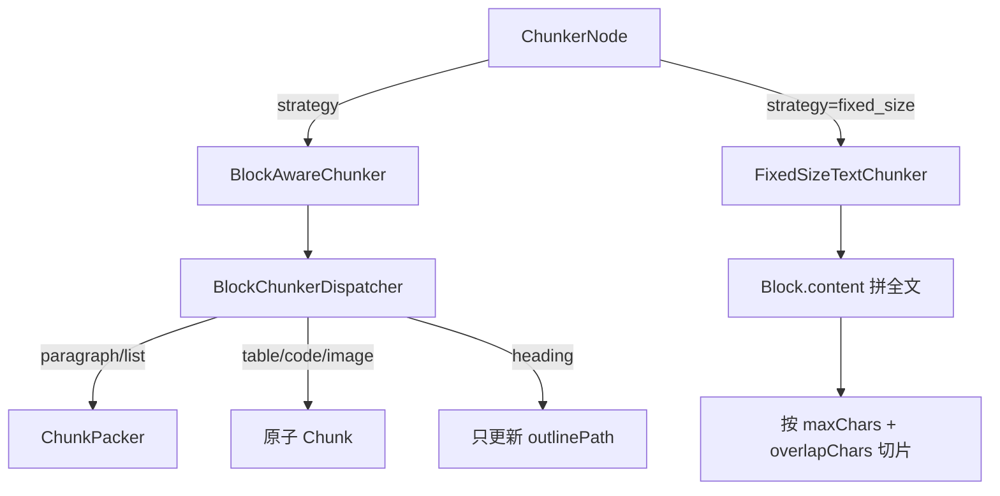

# 知识库 Chunk 分块策略与实现

对应代码目录：`backend/src/modules/ai/core/chunk/`  
Pipeline 入口：`backend/src/modules/ai/ingestion/nodes/chunker.node.ts`  
前置依赖：PARSER / ENHANCER 产出的 `Block[]`（见 [`3 知识库摄取Pipeline节点梳理.md`](./3%20知识库摄取Pipeline节点梳理.md)）

---

## 1. 在摄取链路中的位置

```text
PARSER/ENHANCER → Block[] → CHUNKER → Chunk[] → ENRICHER → INDEXER → DB + 向量库
```

分块目标：把「文档结构单元」变成「适合 embedding / 检索的文本片段」，并尽量保留：

- 语义完整（表格、代码不被腰斩）
- 章节上下文（`outlinePath` / `section`）
- 溯源（`sourceBlockIds`、`startOffset` / `endOffset`）

---

## 2. 代码结构一览

| 文件 | 职责 |
| --- | --- |
| `chunking-strategy.interface.ts` | `ChunkingStrategy` 接口 + `CHUNKING_STRATEGY` token + 策略名联合类型 |
| `chunk.model.ts` | 内存态 `Chunk`、`ChunkingOptions`（落库前中间形态） |
| `block-aware.chunker.ts` | **structure_aware** 策略入口 |
| `block-chunker-dispatcher.ts` | 按 `Block.type` 分发：heading / 可合并 / 原子块 |
| `chunk-packer.ts` | 段落/列表贪心打包到 `maxChars` |
| `fixed-size-text.chunker.ts` | **fixed_size** 策略（纯文本定长 + 字符 overlap） |
| `chunk.module.ts` | 注册并导出两种 Chunker |
| `ingestion/nodes/chunker.node.ts` | Pipeline 节点：读 config 选策略，写 `ctx.chunks` / `ctx.outlinePath` |



---

## 3. 数据模型

### 3.1 `Chunk`（内存，Indexer 再落库）

| 字段 | 说明 |
| --- | --- |
| `index` | 序号（structure_aware 结束时会重编号保证连续） |
| `content` | 文本 |
| `sourceBlockIds` | 来源 Block id，便于追溯与块级 overlap |
| `primaryBlockType` | 主类型；定长策略统一标 `paragraph` |
| `outlinePath` / `section` | 章节路径；`section` = 路径最后一项 |
| `startOffset` / `endOffset` | 字符区间（定长策略相对拼接全文；结构策略在 packer 内相对当前流） |
| `tokenCount` | 估算：`ceil(chars / 4)` |
| `metadata` | 如 `strategy`、`atomic`、`headers`、`language`、`src`、`blockCount` |

### 3.2 `ChunkingOptions`

| 字段 | 谁用 | 含义 |
| --- | --- | --- |
| `maxChars` | 两者 | 单 chunk 目标上限 |
| `overlapChars` | 仅 fixed_size | 相邻 chunk 字符重叠 |
| `blockLevelOverlap` | structure_aware | 是否启用块级 overlap |
| `overlapBlockCount` | structure_aware | 向前携带上一 chunk 尾部几个完整 Block |

### 3.3 ChunkerNode 可配项（管理端表单）

| key | 默认 | 说明 |
| --- | --- | --- |
| `strategy` | `structure_aware` | `structure_aware` / `fixed_size` |
| `maxChars` | `1000` | 100~20000 |
| `overlapChars` | `200` | 定长用；结构感知可忽略 |
| `blockLevelOverlap` | `true` | 结构感知 |
| `overlapBlockCount` | `1` | 结构感知 |

选择逻辑：

```text
config.strategy === 'fixed_size'  → FixedSizeTextChunker
否则                               → BlockAwareChunker
```

执行后额外：`ctx.outlinePath = 所有 heading 的 content`（扁平列表，供文档级大纲展示）。

---

## 4. 本仓库已实现的两种策略

### 4.1 `structure_aware`（默认，推荐）

**入口**：`BlockAwareChunker` → `BlockChunkerDispatcher` + `ChunkPacker`

**设计对比「纯字符切分」**：

| 点 | RecursiveCharacter / fixed_size | structure_aware |
| --- | --- | --- |
| 输入 | 字符串 | 结构化 `Block[]` |
| 表格/代码/图 | 易被切断 | **原子保留**整块成 chunk |
| 段落/列表 | 按字符切 | **贪心合并**到 `maxChars` |
| overlap | 字符截断 | **块级**：上一 chunk 尾部完整 Block 拼到下一 chunk 头 |
| 章节 | 丢失或靠启发式 | heading 维护 `outlinePath` |

**按 Block 类型行为**：

| Block.type | 行为 |
| --- | --- |
| `heading` | 先 flush 待合并段落；按 `level` 弹栈再 push，**不产 chunk** |
| `paragraph` / `list` | 进入 `pendingMerges`，flush 时交给 `ChunkPacker` |
| `table` | flush 后单独原子 chunk；`metadata.headers` |
| `code` | 原子 chunk；`metadata.language` |
| `image` | 原子 chunk；内容优先 `alt`，`metadata.src` |

**贪心打包（ChunkPacker）**：

```text
当前累计 + 下一块（含 \n\n）> maxChars 且当前已有内容
  → 输出当前 chunk，清空，再装下一块
否则继续累加
单块本身超长：仍会单独装入（不在此处再切碎）
```

**块级 overlap（Dispatcher.flushMerges）**：

```text
若已有上一 chunk 且 overlapBlockCount > 0：
  取上一 chunk.sourceBlockIds 尾部 N 个 id
  在本批 pendingMerges 中找同 id 的 content
  拼到新产出的第一个 chunk 的 content 前面
```

注意：overlap 内容来自「本批 pending 里仍出现的 id」，与上一 chunk 尾块对齐；不是任意历史块回放。

**宣称效果**（设计/测试侧）：相对通用字符切分，召回率约 +10%~15%（见 `.agent` 中 T7.5 对比实验说明）。

### 4.2 `fixed_size`（兜底）

**入口**：`FixedSizeTextChunker`

```text
1. fullText = blocks.map(content).join('\n\n')
2. 窗口 [pos, pos+maxChars)，写出 chunk
3. pos = end - overlapChars，直到文末
```

特点：

- 实现简单，与 LangChain `RecursiveCharacterTextSplitter`「定长切」同类（本实现**未**做分隔符递归回退，是更朴素的定长切片）
- 所有 chunk 的 `sourceBlockIds` = **全部** block id（溯源粒度粗）
- `outlinePath` 取 `blocks[0]` 的路径，章节信息不随切分推进更新
- 适合：无结构、全段落、或显式要求定长

---

## 5. 常见分块策略知识补充（业界）

下列策略不限于本仓库已实现项；用于选型与面试/扩展对照。

### 5.1 定长 / 滑动窗口（Fixed Size）

| 项 | 说明 |
| --- | --- |
| 做法 | 按字符数、token 数或字节数切；常加 `overlap` |
| 优点 | 实现简单、长度可控、便于估算 embedding 成本 |
| 缺点 | 切断句子/表格/代码；语义破碎 |
| 适用 | OCR 纯文本、日志、无结构语料、快速基线 |
| 本仓库 | ≈ `fixed_size`（字符级） |

进阶变体：按 **token**（tiktoken / 模型 tokenizer）计长，比纯字符更贴模型上下文。

### 5.2 递归字符分割（Recursive Character）

| 项 | 说明 |
| --- | --- |
| 做法 | LangChain 经典：按分隔符优先级尝试切分（如 `\n\n` → `\n` → 空格 → 空），尽量在语义边界断开且不超过 `chunkSize` |
| 优点 | 比裸定长少切烂段落；无结构依赖 |
| 缺点 | 仍不理解表格/代码块；分隔符需调参 |
| 适用 | Markdown/纯文本默认方案 |
| 本仓库 | 注释对齐该思想；`FixedSizeTextChunker` 尚未做完整分隔符递归 |

### 5.3 结构 / 文档树感知（Structure-aware）

| 项 | 说明 |
| --- | --- |
| 做法 | 先解析为 heading/段落/表/代码等；再按类型规则合并或原子保留 |
| 优点 | 结构完整、章节可过滤、检索噪音低 |
| 缺点 | 依赖 Parser 质量；扫描件/乱版式 PDF 结构差时退化 |
| 适用 | 技术文档、手册、规范、带目录的 PDF/DOCX |
| 本仓库 | **`structure_aware` 主路径** |

变体：Markdown AST 切、HTML DOM 切、Docx 样式切——本质都是「结构单元优先于裸字符」。

### 5.4 语义分块（Semantic Chunking）

| 项 | 说明 |
| --- | --- |
| 做法 | 按句/段 embedding，相邻相似度骤降处切刀；或聚类成主题块 |
| 优点 | 边界贴语义，跨标题也可能合并同主题 |
| 缺点 | 贵（多次 embedding）、慢、阈值敏感、难复现 |
| 适用 | 叙事性强、结构弱的长文；高价值语料精加工 |
| 本仓库 | **未实现**（上传 UI 曾出现 `semantic` 选项名，Pipeline Chunker 仅支持两种策略） |

### 5.5 句子 / 段落窗口（Sentence / Paragraph Window）

| 项 | 说明 |
| --- | --- |
| 做法 | 以句或自然段为原子，再按窗口合并 N 句，或检索时「小块命中 + 扩上下文」 |
| 优点 | 边界自然；小块利于召回、大窗利于生成 |
| 缺点 | 句分割依赖语言；长句/无标点文本难 |
| 适用 | 问答、法律条文（一句一义） |
| 相关模式 | **Parent-Document / Small-to-Big**：索引用小 chunk，返回答案用父段 |

### 5.6 按页 / 按版面（Page / Layout）

| 项 | 说明 |
| --- | --- |
| 做法 | PDF 按页、或按版面区域（栏、图注）成块 |
| 优点 | 与页码引用对齐；扫描件友好 |
| 缺点 | 一页多主题时噪音大；页间话题割裂 |
| 适用 | 论文、报表、需要「第 X 页」引用的场景 |

### 5.7 Agent / LLM 辅助分块

| 项 | 说明 |
| --- | --- |
| 做法 | 让 LLM 标切点或摘要成块 |
| 优点 | 灵活，可带业务规则 |
| 缺点 | 贵、慢、不稳定，难做确定性回归 |
| 适用 | 小规模精品库；不宜作为默认大批量摄取 |

### 5.8 Overlap 怎么选

| 类型 | 含义 | 典型值 |
| --- | --- | --- |
| 字符 overlap | 窗口回退若干字符 | `chunkSize` 的 10%~20% |
| Token overlap | 同上，按 token | 50~200 tokens 视模型而定 |
| 块级 overlap | 重复完整语义单元 | 本仓库默认 1 个 Block |
| 无 overlap | 块边界硬切 | 目录、FAQ、卡片式语料 |

Overlap 过小：边界问答易丢上下文；过大：向量库膨胀、Top-K 被近重复占满。

### 5.9 长度与检索的经验区间

| 场景 | 常见 chunk 量级（字符粗估） |
| --- | --- |
| 短问答 / FAQ | 200~500 |
| 技术文档段落 | 500~1500（本仓库默认 **1000**） |
| 长论述 + 大上下文模型 | 1500~3000，需配合重排与引用截断 |
| 代码块 | 尽量整函数/整文件原子；过大再按符号切 |

最终应以 **embedding 模型上下文** 与 **召回评测（recall@k）** 为准，而不是固定魔法数。

---

## 6. 选型对照（含本仓库）

| 策略 | 本仓库 | 优先场景 | 风险 |
| --- | --- | --- | --- |
| structure_aware | ✅ 默认 | 结构化文档、手册、带表/代码 | Parser 烂则收益下降 |
| fixed_size | ✅ | 无结构文本、兜底、对比基线 | 切散表格/代码 |
| RecursiveCharacter | ❌（可参考实现） | 通用 Markdown | 仍无结构语义 |
| Semantic | ❌ | 精品库精加工 | 成本高 |
| Page-based | ❌ | 强页码引用 | 页内多主题 |
| LLM chunk | ❌ | 小流量定制 | 不稳定 |

**实践建议：**

1. 默认走 **structure_aware** + 调 `maxChars` / `overlapBlockCount`。  
2. 用同一标注集做 **structure_aware vs fixed_size** 的 recall@k（仓库已有对比测试脚手架思路）。  
3. 上传侧若暴露 `semantic` / `character` 等名称，需与 Pipeline 实际 `strategy` **对齐**，避免配置写了但节点未消费。

---

## 7. 与上下游的契约

| 上游 | 需要 |
| --- | --- |
| PARSER | 正确的 `Block.type` 与 `content`；heading 带 `level` |
| ENHANCER | 清洗后的 blocks（去样板等），减少垃圾进 chunk |

| 下游 | 消费 |
| --- | --- |
| ENRICHER | 对 `chunks` 打关键词 / 意图 |
| INDEXER | 写入 `DocumentChunkEntity` + embedding；带上 section、outline、offset、metadata |
| 检索 / 前端切片页 | 用 chunk 内容与 offset 做展示；高亮/联动为可选产品能力 |

---

## 8. 已知局限与可演进点

1. **超长原子块**：单表/单代码超过 `maxChars` 仍整块入 chunk，可能撑爆 embedding 上下文——可演进为「原子优先 + 超长再按行/符号二次切」。  
2. **fixed_size 溯源粗**：所有 chunk 挂全部 `sourceBlockIds`。  
3. **块级 overlap 实现条件**：依赖上一 chunk 尾 id 仍出现在本批 pending 中，跨 flush 边界时行为需结合数据验证。  
4. **上传表单策略名**（如 `semantic`）与 ChunkerNode 枚举不一致时，应收敛配置契约。  
5. **token 计数**：`chars/4` 为粗估；接 OpenAI/本地 tokenizer 更准。

---

## 9. 相关文件速查

```text
backend/src/modules/ai/core/chunk/
  chunking-strategy.interface.ts
  chunk.model.ts
  block-aware.chunker.ts
  block-chunker-dispatcher.ts
  chunk-packer.ts
  fixed-size-text.chunker.ts
  chunk.module.ts
backend/src/modules/ai/ingestion/nodes/chunker.node.ts
backend/src/modules/ai/core/parser/block.model.ts
doc/project note/3 知识库摄取Pipeline节点梳理.md   # §2.4 CHUNKER 摘要
```
