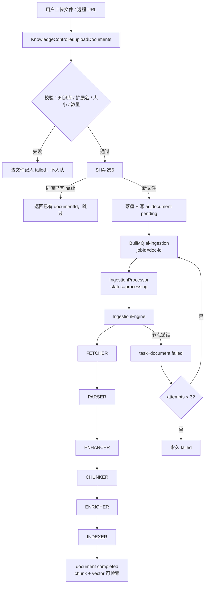
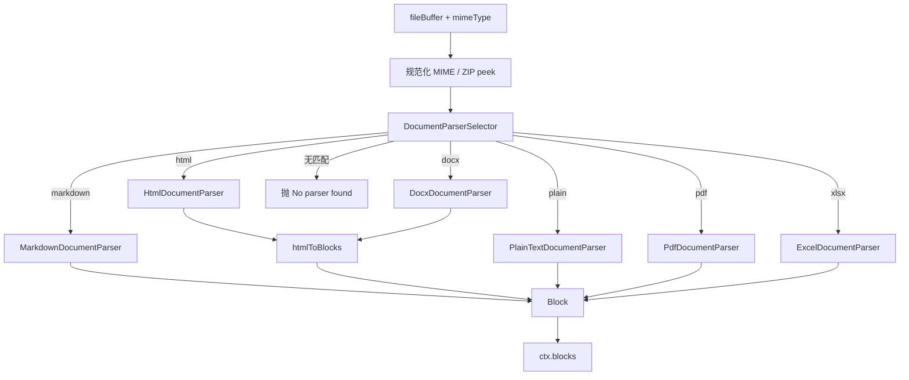

# 7. RAG 离线摄取 Pipeline 端到端流程

> 对应代码：`backend/src/modules/ai/knowledge/`（上传/入队）、`ingestion/`（编排与节点）、`core/parser` + `core/chunk`（解析与分块）、`intent/`（离线打标）、`rag/vector/`（向量落库）  
> 专题笔记：`3` [节点编排](./3%20知识库摄取Pipeline节点梳理.md) · `4` [分块](./4%20知识库Chunk分块策略与实现.md) · `5` [解析](./5%20知识库文档解析逻辑与知识点.md) · `6` [Enricher/Intent](./6%20Enricher节点与Intent意图识别.md)  
> 范围：**离线写侧**（上传 → 解析 → 切分 → 打标 → 向量化）。在线问答检索见笔记 6 后半与 RAG 通道实现。

---

## 0. 一句话与分层

离线摄取把「用户丢进来的文件」变成「可检索的 Chunk + 向量」。HTTP 只负责校验、落盘、入队；真正干活的是 BullMQ Worker 里的 `IngestionEngine`，按 Pipeline 链表串 6 个节点。

```text
┌──────────── HTTP 同步 ────────────┐     ┌──────────── BullMQ 异步 ────────────┐
│ 上传 → 校验 → 落盘 → 写 Document  │ ──► │ Worker → Engine → 6 节点 → 向量库  │
│ indexStatus = pending             │     │ processing → completed / failed    │
└───────────────────────────────────┘     └────────────────────────────────────┘
```

| 层   | 目录                                                                    | 做什么                                                        |
| --- | --------------------------------------------------------------------- | ---------------------------------------------------------- |
| 入口  | `knowledge/knowledge.controller.ts` + `knowledge.service.ts`          | 收文件、校验、去重、写盘、入队                                            |
| 队列  | `knowledge/ingestion/ingestion.service.ts` + `ingestion.processor.ts` | `ai-ingestion` 队列，concurrency=5，失败最多 3 次                   |
| 编排  | `ingestion/ingestion-engine.ts`                                       | 按 `nextNodeId` 跑节点，写 Task / TaskNode                       |
| 节点  | `ingestion/nodes/*.node.ts`                                           | FETCHER / PARSER / ENHANCER / CHUNKER / ENRICHER / INDEXER |
| 能力  | `core/parser`、`core/chunk`、`intent`、`rag/vector`                      | 被节点调用的可复用实现                                                |

默认 Pipeline（`seed-default-pipeline.ts`）：

```text
fetcher → parser → enhancer → chunker → enricher → indexer
```

---

## 1. 总览：从上传到可检索

按实际代码顺序读这一条即可。括号里是关键失败点。

```text
用户选择文件
  → POST /api/ai/knowledge/documents/upload  (multipart)
  → MultipartInterceptor 把文件读进内存 Buffer ，字段参数提起到body上。通过参数装饰器@MultipartFiles 获取files
  → KnowledgeService.uploadDocuments
        ├ 知识库是否存在
        ├ 单次最多 20 个文件
        ├ 扩展名白名单（.md/.markdown/.pdf/.docx/.xlsx/.txt/.html）
        ├ 单文件 ≤ 50MB
        ├ SHA-256 去重（同知识库同 hash 则跳过，不重复入队）
        ├ 写磁盘 uploads/knowledge/{kbId}/{timestamp}-{原名}
        └ 写 ai_document（indexStatus=pending）
  → IngestionService.enqueueDocument  → BullMQ jobId=doc-{documentId}
  → IngestionProcessor.process
        └ 文档改为 processing
        └ IngestionEngine.execute(documentId)
              ├ 加载 Document / KnowledgeBase / Pipeline
              ├ 建 IngestionTask（running）
              ├ 建 IngestionContext（documentId、kbId、collectionName、filePath）
              └ 从 startNodeId 沿 nextNodeId 走：

                 【FETCHER】读盘 → file-type 魔数 → ZIP 则 peek OOXML[在zip的二进制头部检测类型]
                      → ctx.mimeType + ctx.fileBuffer
                      （缺 filePath 抛错）

                 【PARSER】maxFileSize / preserveRaw / tableRowWindow[配置]
                      → MIME 规范化 + alias + 必要时再 peek ZIP
                      → DocumentParserSelector 按 MIME 选实现
                      → 六选一 parseStructured → Block[]
                      （无 Parser / 扫描 PDF / 超限 → 抛错）

                      【html】htmlToBlocks  JSDOM转HTML文本为DOM walk遍历递归遍历DOM树
                          -> Node.TEXT_NODE 转为 ParagraphBlock
                          -> h1-h6 pushHeading 根据等级维护outlineStack 转为 HeadingBlock[仅累积 outlinePath，不直接产 chunk] 
                          -> p 选中所有img 转为 ImageBlock[src || alt]，克隆后删除img剩余文本转为 ParagraphBlock
                          -> ul/ol 转为 ListBlock[所有子列表li innerText拼接]
                          -> table 提取行数据(tr -> th,td)  和 表头(如果有thead， row[0]为表头，否则生成列名) 转为 TableBlock[将行数据序列化和markdown格式表格]
                          -> pre 识别code标签和 language[codeEl.getAttribute('class')] 转为 CodeBlock[code标签的textContent]
                          -> img 转为 ImageBlock[src || alt]
                          -> blockquote/li、默认 转为 ParagraphBlock

                      【docx】 mammoth 转 HTML 后走与 HtmlDocumentParser 同一套 DOM → Block

                      【markdown】 marked.lexer 解析 markdown 为 tokens
                      
                      【pdf】使用pdf-parse解析 根据全文总字符小于阈值判断是否为扫描件(报错) 正则提取可能的标题、子标题，否则为段落 

                      【excel】使用exceljs解析 sheet.name作为1级标题进outlinePath并生成HeadingBlock  首行作为headers 如果存在headers和行 按照windowSize切分，每个窗口合并headers序列化为md表格 不存在headers 每行 join(' | ')为ParagraphBlock
                      
                      【plainText】按空行切成段落，去除空格后每行转为ParagraphBlock，首段落(小于80字符)作为title

                 【ENHANCER】换行归一、压空行、丢掉空 Block
                      → 可选写入 metadata.author / source(配置摄取流水线时节点配置)

                 【CHUNKER】structure_aware（默认）或 fixed_size
                      → Chunk[] + outlinePath
                      【fixed_size】 按照maxChars为窗口slice，每次切完后位置回退overlapChars
                      【structure_aware】paragraph和list加入pendingMerges，heading、table、code、image刷新需要合并的block(flushMerges)后单独一个chunk。flushMerges中贪心合并block到最大字符数maxChars，把上一 chunk 尾部 N 个完整 Block 拼到本批第一个 chunk 开头（默认 N=1）；pack 内相邻 chunk 不做重叠。用完整语义单元保上下文、避免字符切断；重叠只补「结构断点」缝，少叠以防近重复膨胀。fixed_size 才是每个窗口都字符回退 overlap 的兜底策略。

                 【ENRICHER】词频 Top10 关键词(符号分割，过滤长度>2的词，统计词频)
                      → ChunkIntentTagger 给每个 chunk 打 KB 意图(从redis获取active的知识库KB的叶子意图，chunk content、section、outlinePath拼接作为haystack对比文本打分。包含意图name + 3，意图树路径/分割后每项 + 1，example + 3，example分词后50% + 2， description 分词取前 12 词，命中 ≥ 2 个)
                      → 得分大于阈值写入metadata.intentNodeId / path / score

                 【INDEXER】MySQL：删旧 chunk → 写新 chunk
                      → 按 document_id 清旧向量 → embedBatch → INSERT 新向量
                      → is_embedded=true
                      → 文档 indexStatus=completed、chunkCount、outlinePath
                      → 已改 Postgres 后若 MySQL 失败：补偿再按 document_id 删向量
                      →（装饰器）best-effort 同步关键词索引（目前 mock）

  → Task completed；文档 completed
  （任一步抛错 → Task failed + 文档 failed；BullMQ 指数退避重试，最多 3 次）
```



---

## 2. 阶段 0：上传与校验（同步 HTTP）

入口：`POST /api/ai/knowledge/documents/upload`  
实现：`knowledge.controller.ts` → `knowledge.service.ts`

### 2.1 请求形态

- `multipart/form-data`：本地文件（可多文件）
- `sourceType=remote_url`：服务端 `fetch(url)` 再当文件处理

`processMode=pipeline` 时 DTO 要求带 `pipelineId`；未指定时 Engine 会找「默认 Pipeline」（见 §3.2）。

### 2.2 实际生效的校验

| 检查    | 位置         | 规则                                              | 不通过时           |
| ----- | ---------- | ----------------------------------------------- | -------------- |
| 知识库存在 | Service    | `kbRepo.findOne`                                | 404            |
| 文件必填  | Controller | 非 remote 且无 files                               | 400            |
| 批量数量  | Service    | `MAX_FILES_PER_UPLOAD = 20`                     | 400 整单拒绝       |
| 扩展名   | Service    | `.md .markdown .pdf .docx .xlsx .txt .html`     | 该文件进 `failed`  |
| 大小    | Service    | `MAX_FILE_SIZE = 50MB`                          | 该文件进 `failed`  |
| 内容去重  | Service    | `sha256(buffer)`，同 `knowledgeBaseId + fileHash` | 返回旧文档，**不再入队** |

远程 URL 同样走扩展名（有后缀时）和 50MB 校验。

### 2.3 已写但未挂上请求的能力

| 组件                     | 意图                                                      | 现状                                 |
| ---------------------- | ------------------------------------------------------- | ---------------------------------- |
| `UploadRateLimitGuard` | multipart 解析前用 Content-Length 拦超大文件；Redis Semaphore 限并发 | Controller 上 `@UseGuards` **被注释掉** |
| `DocumentSanitizer`    | 向量化前替换身份证/手机/银行卡/邮箱                                     | **未接入** FETCHER/ENHANCER/INDEXER   |

因此「安全」当前主要是：扩展名白名单 + 大小上限 + 哈希去重。MIME 真伪在 FETCHER 用魔数纠正，不在上传瞬间拒收伪造后缀。

### 2.4 落盘与文档记录

路径：`uploads/knowledge/{knowledgeBaseId}/{Date.now()}-{originalname}`

`ai_document` 关键字段：`filePath`、`fileType`（扩展名去掉点）、`fileHash`、`indexStatus=pending`、`pipelineId`、`splitStrategy` / `chunkSize` 等切分配置。

注意：切分**真正生效的是 Pipeline 节点 config**（默认 `maxChars=1000`）。文档上的 `splitStrategy` / `chunkSize` 会入库，但 `ChunkerNode` **不读 Document 字段**，只读 `t_ingestion_pipeline_node.config`。

---

## 3. 阶段 1：入队与 Worker

### 3.1 入队

`IngestionService.enqueueDocument(documentId, userId)`

- 队列名：`ai-ingestion`
- `jobId = doc-{documentId}`：同一文档同时只有一个 job；重试/重建会先 `remove` 旧 job
- payload：`{ documentId, userId }`
- 默认：`attempts=3`，指数退避 `delay=5000`

### 3.2 Worker

`IngestionProcessor`（`concurrency: 5`）

1. `indexStatus = processing`
2. `IngestionEngine.execute(documentId)`
3. 成功：文档状态由 INDEXER 写成 `completed`（Engine 不在成功路径再改文档）
4. 失败：立刻把文档标 `failed` 并 `throw`，交给 BullMQ 重试
5. `onFailed`：若 `attemptsMade >= maxAttempts`，写成「重试 N 次后仍失败」

### 3.3 Engine 选哪条 Pipeline

```text
doc.pipelineId
  → 有则用它
  → 无则 getDefaultPipelineId()：status=1 且 id 最小的一条
```

种子数据会把「默认摄取 Pipeline」标 `isDefault=true`。Engine 选默认时看的是 `status=1` **+ 最小 id**，不是 `isDefault` 字段。多条启用 Pipeline 时，要以 id 最小的为准。

---

## 4. 阶段 2：Engine 怎么串节点

文件：`ingestion-engine.ts`

```text
加载 Document / KB / Pipeline / 全部 PipelineNode
→ 创建 IngestionTask(status=running)
→ new IngestionContext({ documentId, knowledgeBaseId, collectionName })
   ctx.metadata.filePath = doc.filePath
→ current = nodeMap.get(pipeline.startNodeId)
→ while current 且 iteration < 100:
     写 TaskNode(running)
     解析 conditionJson → ConditionEvaluator
       不满足 → TaskNode skipped，跳到 nextNodeId
     registry.get(nodeType).execute(ctx, node.config)
       返回 false → 整条链停止（当前节点仍记 success）
       抛错 → TaskNode error，Task failed，文档 failed，向外抛
     TaskNode success（output 含 blockCount/chunkCount）
     current = nextNodeId
→ Task completed
```

条件语法（`condition-evaluator.ts`）：`eq/ne/in/contains`，以及 `all` / `any` / `not`。字段路径如 `mimeType`、`metadata.author`。默认种子 **conditionJson 全是 null**，六个节点都会跑。

防死循环：`maxIterations = 100`。

---

## 5. FETCHER：读文件 + 认 MIME

文件：`ingestion/nodes/fetcher.node.ts` + `core/parser/mime-utils.ts`

```text
ctx.metadata.filePath
  → fs.readFile
  → inferMimeType(path, buffer)
        1. file-type.fromBuffer（魔数）
        2. 若是 application/zip → peek ZIP 条目
             word/ → docx MIME
             xl/   → xlsx MIME
             ppt/  → pptx MIME（目前没有 PPT Parser，后面 PARSER 会失败）
        3. ZIP peek 失败且后缀是 office → 回退后缀并 warn
        4. 魔数与后缀不一致 → warn，仍以内容为准
        5. 魔数认不出（md/txt/html 常见）→ 用后缀映射
  → ctx.filePath / ctx.mimeType / ctx.set('fileBuffer', buffer)
```

后缀映射：`.md/.markdown`→markdown，`.pdf`→pdf，`.docx`→docx，`.xlsx`→xlsx，`.xls`→ms-excel，`.txt`→plain，`.html/.htm`→html。

上传白名单没有 `.xls` / `.htm`，但 FETCHER 认得出这两种后缀。PPT 能被 peek 成 pptx MIME，PARSER 无实现会报 `No parser found`。

---

## 6. PARSER：按 MIME 选实现 → Block[]

文件：`ingestion/nodes/parser.node.ts` → `core/parser/document-parser-selector.ts`

### 6.1 节点配置

| key              | 默认    | 作用                                       |
| ---------------- | ----- | ---------------------------------------- |
| `preserveRaw`    | false | HTML/DOCX 把原始 HTML 写入 `metadata.rawHtml` |
| `maxFileSize`    | null  | Selector 再拦一次字节上限                        |
| `tableRowWindow` | 40    | 仅 Excel：大表按窗口切多个 TableBlock              |

### 6.2 路由

```text
resolveParserMime（规范化小写、去 charset、alias、zip 再 peek）
→ 各 Parser.supportedMimeTypes 做 canonical 匹配
→ getOrder 升序取第一个
→ parseStructured(buffer, mime, options)
```

| Parser   | MIME                                | order | 产物要点                                            |
| -------- | ----------------------------------- | ----- | ----------------------------------------------- |
| Markdown | `text/markdown`、`text/x-markdown`   | 10    | heading/p/list/table/code/image；html 片段可走 jsdom |
| HTML     | `text/html`、`application/xhtml+xml` | 12    | jsdom → 六种 Block                                |
| 纯文本      | `text/plain`                        | 15    | 空行分段，不走 Markdown lexer                          |
| PDF      | `application/pdf`                   | 20    | 按页抽文本 + 弱标题；`metadata.page`；字太少当扫描件抛错           |
| DOCX     | OOXML word                          | 30    | mammoth HTML → 与 HTML 同一套 `htmlToBlocks`        |
| Excel    | xlsx / ms-excel                     | 40    | sheet Heading + 窗口 TableBlock                   |

六种 Block：`heading` / `paragraph` / `list` / `table` / `code` / `image`。PARSER 还补 `language`（启发式 zh/en）、`wordCount`。细节见笔记 5。



---

## 7. ENHANCER：清洗，不补结构

文件：`ingestion/nodes/enhancer.node.ts`

1. `\r\n` → `\n`，连续 3 个以上换行压成 2 个，trim
2. config 里有 `author` / `source` 则写入 `ctx.metadata`
3. 丢掉 `content.length === 0` 的 Block

**做不到的**：PARSER 丢掉的表格/标题，这里补不回来。身份证等脱敏组件存在但未调用。

---

## 8. CHUNKER：Block[] → Chunk[]

文件：`ingestion/nodes/chunker.node.ts` + `core/chunk/`

默认种子：`strategy=structure_aware`，`maxChars=1000`，`overlapBlockCount=1`。

```text
strategy === 'fixed_size'
  → 拼全文 → 按 maxChars 切片 + overlapChars
  → primaryBlockType 一律 paragraph

否则 structure_aware
  → BlockChunkerDispatcher 按 type 走：
       heading  → 只更新 outlinePath，不产 chunk
       paragraph/list → ChunkPacker 贪心合并到 maxChars
       table/code/image → 原子 chunk（整块不拆）
       块级 overlap：新 chunk 开头带上上一 chunk 尾部 N 个完整 Block
  → 重编号 index
```

同时从所有 HeadingBlock 抽出 `ctx.outlinePath`（文档级大纲）。分块语义见笔记 4。

Excel 大表已在 PARSER 按行窗口切开，所以 CHUNKER 看到的是多个「较小的原子表」，而不是一张超大表。

---

## 9. ENRICHER：关键词 + 离线意图打标

文件：`ingestion/nodes/enricher.node.ts` + `intent/chunk-intent-tagger.ts`

### 9.1 关键词

所有 chunk 按空白/中英标点分词，长度 > 2，全局词频 Top 10 → `ctx.keywords` 与 `metadata.keywords`。

### 9.2 意图（仅离线、无 LLM）

`tagIntent !== false`（默认开）时：

```text
IntentTreeCacheService.getActiveLeaves()
  → 只要 kind=KB 的 TOPIC 叶子
  → 每个 chunk：
       haystack = content + section + outlinePath（小写）
       对每片叶子打分（名称+3 / 路径段+1 / 示例+3 或词重叠+2 / 描述+1）
       top-1 且 ≥ intentMinScore（默认 2）才写入
  → chunk.metadata.intentNodeId / intentNodePath / intentTagScore
```

无 KB 叶子则整批跳过。INDEXER 把 metadata 原样进 `ai_document_chunk` 和向量表 JSON，检索侧 `IntentDirected` 用 `intentNodeId` 过滤。在线分类与降级见笔记 6。

---

## 10. INDEXER：落库 + 向量化

文件：`ingestion/nodes/indexer.node.ts` → `KeywordSyncingVectorStore` → `PgVectorStoreService`  

逐步流程、双库事务、HNSW / cosine / 共享 collection：见 `[8 INDEXER落库与向量库知识点](./8%20INDEXER落库与向量库知识点.md)`。

`chunks.length === 0` 时节点直接 `true` 通过，**不会**把文档标 completed（Engine 成功结束也不会改文档）。空解析结果可能一直停在 `processing`，属边界行为。

有内容时，MySQL 事务内写 chunk；Postgres 单独提交。写新向量前按 `document_id` 清旧向量；已改过 Postgres 后 MySQL 失败则补偿删除：

```text
1. DELETE ai_document_chunk WHERE document_id = ?
2. INSERT chunks（is_embedded=false），带 section / outlinePath / blockType / metadata
3. vectorStore.deleteDocumentVectors(documentId)
4. vectorStore.indexDocumentChunks(saved, collectionName)
      embedBatch(texts)
      INSERT ai_vector_embedding
        collection_name, chunk_id, document_id, knowledge_base_id,
        content, metadata{section, blockType, outlinePath, ...chunk.metadata}, embedding
5. UPDATE chunks SET is_embedded=true
6. UPDATE document SET index_status=completed, chunk_count, outline_path
   （MySQL 失败且已执行过 3：再 deleteDocumentVectors 一次）
```

向量库：全库一张表 + `collection_name` 标量过滤（知识库隔离）。写向量成功后装饰器 **best-effort** 调关键词索引；当前 `syncToKeywordIndex` 只打日志（ES 未接）。装饰器失败不回滚向量。

---

## 11. Context 数据流（节点契约）

同一 `IngestionContext` 贯穿全程；`fileBuffer` 走 `ctx.set/get`，避免 `toJSON` 把大 Buffer 打进日志。

| 阶段       | 写入                                                                  | 后续谁读     |
| -------- | ------------------------------------------------------------------- | -------- |
| Engine   | `documentId`、`knowledgeBaseId`、`collectionName`、`metadata.filePath` | FETCHER  |
| FETCHER  | `filePath`、`mimeType`、`fileBuffer`                                  | PARSER   |
| PARSER   | `blocks`、`metadata.parser/language/wordCount/pageCount`             | ENHANCER |
| ENHANCER | 清洗后 `blocks`、可选 author/source                                       | CHUNKER  |
| CHUNKER  | `chunks`、`outlinePath`                                              | ENRICHER |
| ENRICHER | `keywords`、chunk.metadata 意图字段                                      | INDEXER  |
| INDEXER  | MySQL chunks + PGVector + 文档状态                                      | 在线检索     |

文档状态机：

```text
pending（入队） → processing（Worker 开始） → completed（INDEXER 事务成功）
                                          ↘ failed（节点抛错或重试用尽）
```

`retryDocument` 只接受 `failed`：改回 pending 再入队。知识库 `rebuild`：清向量、删 chunks、全部文档 pending 后逐个入队。

---

## 12. 和在线 RAG 怎么接上

离线写完后，对话侧不跑这 6 个节点。完整在线链路见 `[9 在线Chat Pipeline与RAG检索](./9%20在线Chat%20Pipeline与RAG检索.md)`。检索读的是：

```text
用户问题 → IntentResolver（LLM 打分，在线）
        → IntentDirected 通道：
             WHERE (metadata->>'intentNodeId')::int IN (命中的 KB 节点)
        → 空结果则去掉过滤再搜（兼容未打标的老数据）
```

写侧关键词打标、读侧 LLM 分类，靠同一个 `intentNodeId` 对齐。意图树改名/新增后，**存量 chunk 不会自动重打标**，需要重新摄取或以后做「只改 metadata 的 Job」。

---

## 13. 调试时按链路看

| 现象                                   | 优先查                                                           |
| ------------------------------------ | ------------------------------------------------------------- |
| 上传成功但一直 pending                      | Redis/BullMQ 是否起来；`GET .../queue/debug`                       |
| processing 后 failed「No parser found」 | FETCHER 日志里的 mime；是否 zip/pptx/未知类型                            |
| PDF 明确报扫描件                           | 正常拒绝；需要 OCR/MinerU，当前没有                                       |
| 表格检索很差                               | PARSER 是否真产出 TableBlock（DOCX 已走 htmlToBlocks）；CHUNKER 原子表是否过大 |
| 意图过滤零召回                              | chunk.metadata.intentNodeId；KB 叶子是否为空；是否触发检索降级日志              |
| 切分大小和上传表单不一致                         | 改的是文档字段还是 Pipeline 节点 config                                  |
| 重复上传没进队列                             | 同库 fileHash 命中，属去重                                            |

相关表：`ai_document`、`ai_ingestion_pipeline` / `_node`、`ai_ingestion_task` / `_node`、`ai_document_chunk`、`ai_vector_embedding`、`ai_intent_node`。Redis：队列 `ai-ingestion`，意图树 `ragent:intent:tree`。

---

## 14. 相关文件速查

```text
knowledge/
  knowledge.controller.ts          上传 API
  knowledge.service.ts             校验 / 落盘 / 去重 / 入队
  guards/upload-rate-limit.guard.ts  上传限流（当前未挂）
  sanitizer/document-sanitizer.ts    脱敏（当前未挂）
  ingestion/ingestion.service.ts     入队
  ingestion/ingestion.processor.ts   Worker
ingestion/
  ingestion-engine.ts
  ingestion-context.ts
  condition-evaluator.ts
  seed-default-pipeline.ts
  nodes/{fetcher,parser,enhancer,chunker,enricher,indexer}.node.ts
core/parser/                       MIME、六 Parser、htmlToBlocks
core/chunk/                        structure_aware / fixed_size
intent/chunk-intent-tagger.ts      离线打标
rag/vector/pg-vector-store.service.ts
rag/vector/keyword-syncing-vector-store.ts
```

---

## 15. 一句话

离线摄取是 **「HTTP 只收件，Worker 跑链表」**：魔数认 MIME → 策略选 Parser 出 Block → 结构感知切 Chunk → 关键词意图打标 → MySQL 存 chunk、Postgres 存向量（写前清旧、失败补偿）。RAG 效果差时，先看 MIME/Parser/空扫描件/意图叶子，而不是只调 `maxChars`。