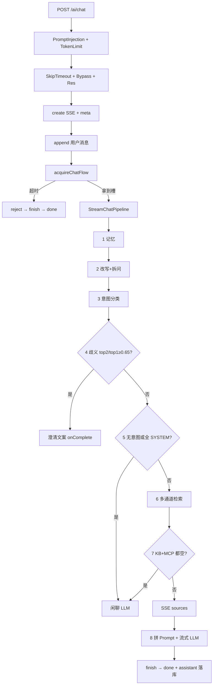

# 9. 在线 Chat Pipeline 与 RAG 检索

> 按一次 `POST /api/ai/chat` 的真实代码顺序写。SSE 连接层细节见 [`13`](./13%20Chat%20SSE流式推送方案.md)；排队限流见 [`14`](./14%20Chat排队限流方案.md)；引用分片见 [`11`](./11%20Chat引用分片回传.md)；离线写库见 [`7`](./7%20RAG离线摄取Pipeline端到端流程.md)；向量 SQL 见 [`8`](./8%20INDEXER落库与向量库知识点.md)；意图树/离线打标见 [`6`](./6%20Enricher节点与Intent意图识别.md)。

产品入口只有 **`/ai/chat`**。`/ai/rag/search`、`/ai/rag/query` 是调试检索用的，对话前端不走。

「RAG」在本仓库不是一个独立函数，而是管道里 **改写 → 意图 → 多通道检索 → 带资料生成**。闲聊 / 歧义 / 空检索会短路，不进资料生成。

---

## 0. 总览（对应你这条提纲）

```text
HTTP ChatController.chat
  守卫 PromptInjection + TokenLimit
  SkipTimeout（跳过 10s 超时）
  Bypass（跳过 ResOp 包装）
  @Res() 无 passthrough
    → ChatService.streamChat
        → SseSenderProvider.create（立刻 SSE 头 + :connected + 心跳）
        → 推 meta（taskId，conversationId 可能还是空）
        → 落库用户消息
        → ChatQueueLimiter.acquireChatFlow（排队许可）
        → StreamChatPipeline 8 段：
             1 加载记忆 loadMemory 从MemoryService.load 加载 摘要summaryService.loadLatestSummary + 历史MemoryService.loadHistory
             2 问题改写 rewriteQuery QueryRewriteService.rewriteWithSplit(question, history) 取最近3轮对话凭借用户提问调用llmGateway.chat 1.补全代词 2.去口语化 3.拆分子问题
             3 解析意图 resolveIntents  IntentResolver.resolve 根据user过滤意图节点（过滤MCP权限，KB/SYSTEM 全进候选）将候选节点和改写后的问题交给 llmGateway.chat 用llm做问题的意图识别  过滤低分并取Top N意图
             4 歧义短路 handleGuidance 每个子问题的意图top2/top1 得分做判定（没有两个意图跳过）高于阈值0.65，callback.onContent返回给客户端意图澄清的回复，并终止程序
             5 闲聊短路 handleSystemOnly 意图树没有命中或者全部为系统意图 直接llmGateway.streamChat闲聊
             6 多通道检索 retrieve  MultiChannelRetrievalEngine.retrieve 
             	-> 无子问题直接走多通道检索（意图、关键词、向量）
             		1. 意图检索IntentDirectedSearchChannel  过滤出问题意图中类型为KB且分数大于等于阈值 对改写问题向量检索PgVectorStoreService.similaritySearchVectorWithScore 拼接 知识库、意图的查询sql  如果携带意图(intentNodeId 元数据)的向量检索没有结果，降级重新查询不带意图元数据 
             		2. 关键词检索KeywordSearchChannel 直接用重写问题作为关键词在Repository<DocumentChunkEntity> like查询 BM25算法计算得分(?什么算法) 
             		3.向量检索VectorGlobalSearchChannel 直接用 PgVectorStoreService.similaritySearchVectorWithScore不带intentNodeIds，按知识库过滤查询   
             		-> 3个通道并行检索完成后 开始postProcessor 
             			1.去重处理 DeduplicationPostProcessor 使用Map根据chunk.chunkId去重，通道来源按照通道优先级、分数按照最大分数保留  
             			2.融合处理fusion 使用score = Σ 1/(k + rank + 1)，k=60，用Map存储，相同累加分数 排序后截断RERANK_CANDIDATE_LIMIT 
             			3.重排处理Rerank(!未实现 用Noop空函数兜底)
                 -> 有子问题
                 	-> 无意图 走多通道检索
                 	-> 意图类型为MCP  executeMcpAndMerge 获取所有注册的mcp，根据toolId调用工具  LLMMcpParameterExtractor.extract 使用 llm提取参数 后执行
                 	-> 意图类型为知识库KB 走多通道检索
             7 空结果再短路 handleEmptyRetrieval 通道检索为空 llmGateway.streamChat闲聊
             8 拼 Prompt + 流式 LLM（首包探测 + 模型降级）
        → SSE sources / message / finish / done
        → assistant 落库
        → waitUntilClosed
```



---

## 1. HTTP：守卫、SkipTimeout、Bypass

文件：`chat/chat.controller.ts`。

```text
@Controller('ai/chat')
@UseGuards(PromptInjectionGuard, TokenLimitGuard)
  POST /               ChatDto → 默认 stream=true
  POST /cancel         { taskId } 取消
```

`ChatDto`：`message`（≤5000）、可选 `conversationId`、`deepThinking`、`stream`。**没有知识库 ID**。对话检索不按库过滤，见第 8 节。

### 1.1 两个守卫（进入 Service 之前）

**PromptInjectionGuard**：从 body 的 `message` / `question` / `query` / `content` 取第一段非空字符串，用中英正则扫「忽略以上指令」「你现在是」「system:」等。命中抛 `PROMPT_INJECTION_DETECTED`，本次请求不会建 SSE。

**TokenLimitGuard**：读 Redis `ragent:token:usage:{userId}:{日期}`。普通用户 10 万、带 `vip` 角色 50 万。超限抛 `TOKEN_LIMIT_EXCEEDED`。  
`incrementTokenUsage` **目前没有业务调用**，流式 `tokensUsed` 也先填 0，所以这个守卫实际上几乎拦不到人。

守卫失败走全局异常过滤，返回 JSON 业务错误，不是 SSE。

### 1.2 `@SkipTimeout`

全局 `TimeoutInterceptor` 默认 10s。流式生成远超 10s，方法上 `@SkipTimeout()` 跳过。否则管道跑到一半会被掐成超时。

### 1.3 `@Bypass` + `@Res()`

`TransformInterceptor` 默认把返回值包成 `{ code, data, message }`（`ResOp`）。SSE 已经在 `reply.raw` 上写了 `text/event-stream`，再包一层会让 Fastify 对已写出的流 `send(object)` → 500。

`@Bypass()` 跳过包装。`@Res()` **不要 passthrough**：Nest 若在 handler 返回后仍 finalize 响应，会出现 `writableEnded`，LLM 首包报 `stream-ended`。

流式路径：

```ts
await this.chatService.streamChat(dto, user, reply)
return   // 不再 reply.send
```

非流式：`reply.status(200).send(ResOp.success(data))`，这时需要包装，所以 Bypass 只保证「流式别包」；非流式由 Controller 自己 `ResOp.success`。

---

## 2. ChatService.streamChat：先连上，再干活

文件：`chat/chat.service.ts`。硬约束：**`sseSender.create(reply)` 之前禁止任何 await**。

| 步 | 做什么 | 为何 |
| --- | --- | --- |
| 同步 | 雪花 `taskId` | 取消、日志、meta 都用它 |
| 同步 | `sseSender.create(reply)` | hijack、200、SSE 头、flush、`: connected`、2s `:ping` |
| 同步 | 立刻 `event: meta` | 前端拿到 taskId；避免代理 idle 只看到空头 |
| 此后才 await | 校验/新建会话，`memoryService.append` 用户消息 | 落库可以慢，心跳顶着连接 |
| | 会话是新建的则再推一次 meta | 补上真实 `conversationId` |
| | `StreamChatEventHandler.init({ skipMeta: true })` | 注册取消回调，不重复 meta |
| | `queueLimiter.acquireChatFlow` | 全局并发槽；排队推 `queue`；超时 `reject→finish→done` |
| | `void pipeline.execute(ctx)` | **不等**管道 Promise |
| | `await sender.waitUntilClosed()` | 等 SSE 真正关掉，Nest 才收尾 |
| finally | `handle.release()` | 归还排队槽 |

`pipeline.execute` 挂在后台：失败走 `handler.onError`。Service 只等连接关闭。

非流式 `chat()`：同一条 Pipeline，用 `ResponseCollector` 拼 delta；assistant 在 Service 里 append（带 sources）。不走 SSE。

---

## 3. SSE create 与 meta（连接层）

实现：`core/framework/sse/sse-sender.provider.ts`。完整约束见笔记 13。这里只记和检索流程相关的点。

`create` 设置：

```text
Content-Type: text/event-stream; charset=utf-8
Cache-Control: no-cache, no-transform
Connection: keep-alive
X-Accel-Buffering: no
```

立刻推：

```text
event: meta
data: { "conversationId": "", "taskId": "<雪花>" }
```

前端用 `taskId` 调 `POST /ai/chat/cancel`。连接活着之后，业务事件都是 `sender.send({ event, data })`，JSON 放在 `data:` 行。

心跳 `:ping` 是注释，浏览器不当业务事件。等改写/意图/检索这些 await 时，靠它撑过代理 idle。

---

## 4. 落库用户消息 + 排队许可

### 4.1 会话与用户消息

- 有 `conversationId`：`conversationService.assertOwnedBy`，别人的会话直接失败。
- 无：`create(user.uid)` 新建。
- `memoryService.append(conversationId, userId, { role: 'user', content: dto.message })`。

这句话已经在库里了。后面 Pipeline `loadMemory` 会把它读进 `history`。生成时还会再塞一条 user（改写后的问题），模型会看到「原文 + 改写」两条。

### 4.2 `ChatQueueLimiter.acquireChatFlow`

文件：`chat/ratelimit/chat-queue.limiter.ts`。把 Redis 公平限流翻译成 SSE。展开设计（ZSET + Lua + Semaphore、为何限流、面试问答）见 [`14`](./14%20Chat排队限流方案.md)。

```text
生成 requestId
每 2s 查 ZSET 排名 → event: queue { requestId, rank, estimatedWaitSeconds }
limiter.acquire(maxWaitMs, isCancelled)
  成功 → 返回 { requestId, release }
  用户取消 → 有 permit 则 release，返回 null（cancel 事件由 TaskManager 推）
  超时 → reject「系统繁忙」→ finish(messageId=null) → done → close
```

没拿到 handle 时 Service `waitUntilClosed` 后返回，**不进 Pipeline**。拿到后才组 `StreamChatContext` 跑 8 段。Pipeline `finally` 必须 `handle.release()`。

---

## 5. Pipeline 上下文

文件：`chat/pipeline/stream-chat.context.ts`。Builder 一次性塞不可变输入，阶段用 setter 填中间态。

| 阶段 | 字段 |
| --- | --- |
| 入口 | `question`（用户原文）、`conversationId`、`userId`、`taskId`、`deepThinking`、`callback`、`user` |
| 1 | `history` |
| 2 | `rewriteResult`：`rewrittenQuestion` + `subQuestions[]` |
| 3 | `subIntents[]`：每个子问题一组 `nodeScores` |
| 6 | `retrievalContext`：`kbChunks` + `mcpEvidences` |

`callback` 流式是 `StreamChatEventHandler`（推 SSE + 落库）；非流式是收集器。Handler 额外有 `onSources`。

编排：`chat/pipeline/stream-chat.pipeline.ts`。阶段有强依赖（意图必须在改写后），所以不用责任链；`handleXxx` 返回 `true` 表示已处理并结束。

---

## 6. 阶段 1：记忆 `loadMemory`

`MemoryService.load`：并行取最新摘要 + 最近 **8 轮（16 条）** user/assistant。有摘要则插在历史最前面。

失败返回 `[]`，不中断对话。

assistant 落库后若 user 累计够多，**异步** `compressIfNeeded`（Redlock），不阻塞本轮回答。

---

## 7. 阶段 2：改写 + 拆问 `rewriteQuery`

文件：`rag/rewrite/query-rewrite.service.ts`。

再调一次 LLM（`temperature=0.1`，`callType=query_rewrite`）。只用 history 最近 **6 条**。任务：补代词、去口语、多问拆成 `subQuestions`。只要 JSON：

```json
{ "rewrittenQuestion": "...", "subQuestions": ["...", "..."] }
```

解析失败或围栏剥不干净 → **退回原文**，`subQuestions = [原文]`。磁盘上的 `query-rewrite.st` **当前没用**，提示词写在代码里。

后面检索、意图、生成用的都是 **改写后的主问题**。向量通道 **只 embed 这一句**，不是每个子问题各 embed 一次。

---

## 8. 阶段 3：意图 `resolveIntents`

文件：`intent/intent.resolver.ts`、`default-intent.classifier.ts`。离线给 chunk 打 `intentNodeId` 见笔记 6；这里是读侧给 **用户问题** 分类。

对 **每个子问题串行** 调分类器（管道注释写「并行」，实现是 `for...of await`）：

1. Redis 意图树取启用中的叶子。传入 `user` 时：KB/SYSTEM 全留，MCP 叶子还要 `toolId` 在该用户可见工具里。
2. LLM 一次给 **全部候选** 打 0~1 分（`temperature=0.1`，`topP=0.3`，`callType=intent_classify`）。编造的 id 丢掉。
3. `score < 0.35` 丢掉，最多留 Top 3。

某个子问题抛错 → 该题 `nodeScores=[]`，**不中断**整次对话。

`kind` 决定后面走哪条：

| kind | 含义 |
| --- | --- |
| KB | 去知识库搜（向量 / 关键词） |
| MCP | 调工具，结果当 evidence 塞进 Prompt（不是模型自己 function call） |
| SYSTEM | 闲聊 / 系统向，不检索 |

---

## 9. 阶段 4：歧义短路 `handleGuidance`

管道 **注入了** `IntentGuidanceService`，**没有调用**。自己算：某个子问题同时有 top1、top2，且 `top2.score / top1.score ≥ 0.65`，就 `onContent` 固定澄清文案（两个 `nodePath`）+ `onComplete`，**不检索、不调生成模型**。

没有二次 LLM 确认（完整逻辑在 GuidanceService 里给别的调用方用）。

Handler 收到 `onComplete`：flush 缓冲 → append assistant（这段澄清文案）→ `finish` → `done`。

---

## 10. 阶段 5：闲聊短路 `handleSystemOnly`

任一即走 `streamChitchat`：

- 没有任何子问题，或每个子问题 `nodeScores` 都空（「你好」、全低于 0.35、意图树为空、分类全失败）
- 有命中，但全部是 SYSTEM

消息：`[...history, { user: 改写后的问题 }]`，`temperature=0.7`，**不带知识库**。`callType=rag_generation`。句柄 `taskManager.bindHandle`，取消才能停模型。

---

## 11. 阶段 6：多通道检索 `retrieve`（核心）

文件：`rag/retrieve/multi-channel-retrieval.engine.ts`。

管道组 `SearchContext`：

| 字段 | 对话入口实际值 |
| --- | --- |
| `originalQuestion` / `rewrittenQuestion` / `subQuestions` / `subIntents` | 来自上文 |
| `topK` | **5** |
| `similarityThreshold` | 未传，默认 **0.7** |
| `knowledgeBaseIds` | **空数组** |

因此 pgvector **不按知识库过滤**，全表近邻，再用 0.7 滤掉不够像的。专有名词对不上、分数偏低时，这里最容易变成「检索为空」。

### 11.1 子问题怎么分叉

`subIntents` 为空（旧链路）→ 只跑一次多通道。

有子问题时，每个子问题进并发 4 的 `p-queue`，看 **该子问题 top1**：

| top1 | 做什么 |
| --- | --- |
| 没有 | 多通道兜底 |
| MCP | 提参 + 调工具，**不跑 KB 通道** |
| KB | 多通道检索 |
| SYSTEM | 返回空（上层若不是「全部 SYSTEM」不会在阶段 5 短路） |

然后 `RetrievalContext.merge` 拼在一起。

实现细节：KB 子问题调用 `executeMultiChannel(context)` 时传入的是 **整次请求的 SearchContext**（里面是全部 `subIntents`），不是「只含当前子问题」。两个 KB 子问题会 **整表检索跑两遍再合并**。意图通道收集的 `intentNodeIds` 也是所有子问题里 `KB && score≥0.35` 的 id。

### 11.2 三个通道（`isEnabled` 自决，引擎无 if-else）

单通道失败基类 catch 后返回 `[]`，不拖垮整次检索。`Promise.all` 并行，总延迟≈最慢通道。

**IntentDirected（priority=1，最窄）**

- 启用：任一子问题有 `KB && score≥0.35`
- embed **改写后的主问题**
- SQL 加 `(metadata->>'intentNodeId')::int IN (...)`（离线 ENRICHER 打的）
- 带过滤结果为空 → **去掉意图过滤再搜一次**。日志：`过滤为空，降级为无意图过滤向量检索`
- 仍受 `topK=5`、`similarityThreshold=0.7`

**Keyword（priority=5）**

- 启用：改写问题非空（几乎总开）
- **不是** BM25。MySQL `content LIKE '%整句改写问题%'` 且 `is_embedded=true`
- 整句很难作为子串出现在 chunk 里，这个通道经常是空的
- 分数 `1/(名次+1)`，和余弦不可比，所以后面用 RRF

**VectorGlobal（priority=10，最宽）**

- 启用：`subIntents` 为空，**或** 所有子问题里 top1 最高分 **< 0.6**
- 意图很有把握（≥0.6）时关掉，避免全局噪声
- 同样 embed 改写主问题，不按 intent 过滤，也不按知识库（对话入口没传 id）

向量是 `1 - 余弦距离`，越高越像，再和 0.7 比。HNSW / `ef_search=200` 见笔记 8。

### 11.3 后处理（串行）

`Dedup(order=1) → Fusion(5) → Rerank(10)`。

**去重**：按 `chunkId`。多通道命中同一段，留下更「精确」的来源（INTENT < KEYWORD < VECTOR_GLOBAL），分数取较大值。

**RRF 融合**：多于 1 个启用通道才做。`score = Σ 1/(60 + 名次)`，用名次不用原始分。截断到 50 再交给 rerank。只有一个通道则保持原序。

**Rerank**：`RoutingRerankService` 若是 Noop，只 `slice(0, topK)`。失败则保留融合顺序再截断。成功后 `score` 换成 rerank 分，原分放进 `metadata.originalScore`。

### 11.4 MCP

top1 为 MCP 时：没有参数提取器 / 工具注册表 / 工具列表 → debug 后返回空 evidence。有工具则：LLM 抽参（低温度）→ `executor.execute` → 文本/图片/资源收成一段 evidence。失败单工具记 error，不中断其它工具。

这些文本后面进 Prompt，**不是** 再给模型一轮 tool call。

---

## 12. 阶段 7：空检索短路 `handleEmptyRetrieval`

`RetrievalContext.isEmpty()`：KB chunks 和 MCP evidence **都没有**。

管道 **不使用** `answer-chat-empty.st`（模板写着「请说未检索到、禁止编造」），而是再走 `streamChitchat`。空模板只在真正进入 `streamRagResponse` 且 scene=EMPTY 时才会用到；当前空结果在进生成前就被短路了，模型可能用训练知识回答。

---

## 13. 阶段 8：拼 Prompt + 流式 LLM

有检索结果才到这里。先推 sources，再生成。

### 13.1 SSE `sources`

```ts
ctx.callback.onSources(extractSources(retrievalCtx.kbChunks, SOURCE_PERSIST_CONTENT_CHARS))
```

Handler 存完整分片供落库，SSE 再截 preview。闲聊 / 澄清 / 空检索短路 **不会** 调 `onSources`。`finish` 再带一份 preview 兜底。正文引用格式 `[n]` 对齐 `<kb_context>` 的 index，见笔记 11。

### 13.2 Prompt

`PromptContext.scene`：只有 KB → `KB_ONLY`；只有 MCP → `MCP_ONLY`；都有 → `MIXED`。对应 `resources/prompt/answer-chat-*.st`。

KB 模板强调：**只根据 `<kb_context>` 答，禁止外部知识**。资料由 `DefaultContextFormatter` 打成 XML：

```xml
<kb_context>
  <chunk index="1" documentId="..." chunkId="..." section="..." score="0.xxx">
    ...原文...
  </chunk>
</kb_context>
```

多个 KB 意图时，本想按意图分组，但 **没有按 `metadata.intentNodeId` 分组**，而是把同一批 chunks 复制到每个意图块下。

消息：`[system 模板, ...history, user]`。多个子问题则 user 改成「请逐一回答」加编号；一个子问题时 user 就是改写后的主问题。

### 13.3 流式生成：首包探测 + 模型降级

参数：有 MCP 时 `temperature=0.3, topP=0.8`，否则 `0 / 1`。`deepThinking` 传给网关（选带思考的候选）。`callType=rag_generation`。

`LlmGateway.streamChat` → `ModelSelector` 按健康度 / 是否思考排候选 → `ModelRoutingExecutor.executeStreamWithFallback`：

```text
对每个候选：
  熔断则跳过
  ProbeStreamBridge 接真实 callback
  等首包（默认 60s）
    成功 → commit 缓冲给前端，返回取消句柄
    失败 → cancel 该路、discard 缓冲、用户无感切下一个
全部失败 → callback.onError
```

句柄 `taskManager.bindHandle`。Handler 把 token 按 5 个 codepoint 攒成 `message`（`type=response|think`）。

闲聊路径同样走这套网关，只是没有 system 资料模板、温度 0.7。

---

## 14. SSE 收尾与 assistant 落库

Handler 实现 `ChatStreamCallback`。CAS 保证 `onComplete` / `onError` / 取消只收尾一次。

| 事件 | 何时 |
| --- | --- |
| `meta` | create 后立刻；新建会话再补一次 |
| `queue` | 排队中约 2s |
| `sources` | 检索完成、生成前 |
| `message` | response / think，约 5 codepoint 一包 |
| `finish` | 正常结束，带 `messageId` + `sources`；拒绝时 messageId=null |
| `done` | `'[DONE]'`，关连接 |
| `cancel` | 用户取消 |
| `reject` | 排队超时 |

正常 RAG：

```text
onComplete
  → flush 残留 buffer
  → memoryService.append(assistant, sources)
  → event: finish { messageId, sources }
  → event: done
  → sender.close('normal')
  → taskManager.unregister
```

取消：`POST /ai/chat/cancel` → Redis 标记 + Pub/Sub → `cancelLocal` 停 LLM → 尽量 append 已生成正文 → `cancel` + `done`。前端还要 `AbortController.abort()` 断连接。

Service 一直 `waitUntilClosed`，然后返回 `{ conversationId, taskId }`（流式这条返回值不会再被包装成 JSON 给浏览器）。

---

## 15. 和离线数据怎么对上

```text
离线 ENRICHER  → chunk.metadata.intentNodeId
离线 INDEXER   → MySQL 原文 + Postgres embedding（同一 metadata）
在线分类器     → 用户问题 → 若干 nodeId
Intent 通道    → 向量近邻 AND metadata.intentNodeId IN (...)
```

意图树改了，旧 chunk 的 id 不会自动变，要重新摄取。Intent 通道空结果会降级成全局向量，过渡期还能搜到，只是变宽、变吵。

对话入口不传知识库 ID，隔离只靠「向量够不够像」和意图过滤。多个知识库的相近段落可能一起进来。

---

## 16. 出问题先看这

| 现象 | 先怀疑 |
| --- | --- |
| 一发消息连接就断 | `create` 前有没有 await；代理 idle（所以要立刻 meta + ping） |
| 一直排队 / 系统繁忙 | 全局并发槽；`queue` / `reject` |
| 「你好」也去搜知识库 | 阶段 5 没短路：意图树把闲聊打成了 KB |
| 高置信业务问题却闲聊 | 分类全失败或全 < 0.35；或全 SYSTEM |
| 显示在搜但答非所问 | 没过 0.7；Keyword 整句 LIKE 为空；没传知识库导致串库 |
| 意图很准仍搜到别的主题 | Intent 空结果降级成无过滤向量 |
| 两个问题答重了 / 慢一倍 | 多个 KB 子问题对同一 SearchContext 检索了两遍 |
| 澄清弹窗太多 | top1/top2 很接近，0.65 阈值 |
| 检索空了却编答案 | 阶段 7 走了闲聊，没用 empty 模板 |
| 有正文无引用角标 | 没收到 `sources` / `finish.sources`；Prompt 是否用 `[n]` |
| 取消无效 | meta 的 taskId 是否就是 cancel 那个；Pub/Sub 是否起来 |
| 日 Token 拦不住 | 用量没有 incr，流式 usage 为 0 |

---

## 17. 相关文件

```text
chat/chat.controller.ts                 守卫、Bypass、SkipTimeout、流式/非流式
chat/chat.service.ts                    SSE 时序、排队、组装 Context
chat/pipeline/stream-chat.pipeline.ts   8 段编排 + 短路
chat/pipeline/stream-chat.context.ts
chat/handler/stream-chat-event.handler.ts
chat/handler/stream-task.manager.ts
chat/ratelimit/chat-queue.limiter.ts
core/framework/sse/sse-sender.provider.ts
memory/memory.service.ts                历史 8 轮 + 摘要
rag/rewrite/query-rewrite.service.ts
intent/intent.resolver.ts
intent/default-intent.classifier.ts
rag/retrieve/multi-channel-retrieval.engine.ts
rag/retrieve/channel/intent-directed.channel.ts
rag/retrieve/channel/keyword.channel.ts
rag/retrieve/channel/vector-global.channel.ts
rag/retrieve/postprocessor/*            去重 / RRF / rerank
prompt/rag-prompt.service.ts
resources/prompt/answer-chat-*.st
rag/vector/pg-vector-store.service.ts
core/infra-ai/llm/llm.gateway.ts
core/infra-ai/model/model-routing-executor.ts
```

---

一次 `/ai/chat`：先保证 SSE 活着并拿到排队槽，再改写、分类、按意图决定闲聊还是检索。检索是「意图向量 + 整句 LIKE +（不够确信时）全局向量」，去重融合后截 5 条，先推 `sources` 再塞进 Prompt 流式生成。对话请求目前不限定知识库；空检索会降级成普通闲聊而不是「资料不足」模板。
