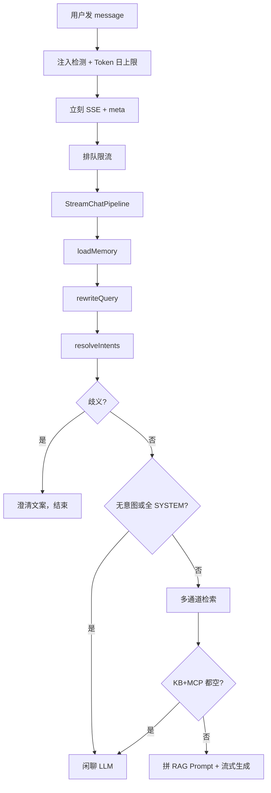

# RAG 在线检索

## 总览流程

```text
HTTP ChatController.chat 守卫、跳过超时SkipTimeout、返回结果封装Bypass
    -> ChatService.streamChat
    -> SseSenderProvider.create立刻建 SSE(请求头设置Content-type text/event-stream) 、推 meta（taskId）
    -> 落库用户消息、取排队许可ChatQueueLimiter.acquireChatFlow
    -> StreamChatPipeline 8 段：
       记忆 -> 改写 -> 意图 -> 歧义/闲聊短路
       -> 多通道检索 -> 空结果再短路
       -> 拼 Prompt -> 流式 LLM（首包探测 + 模型降级）
    -> SSE message / finish / done，assistant 落库
```


