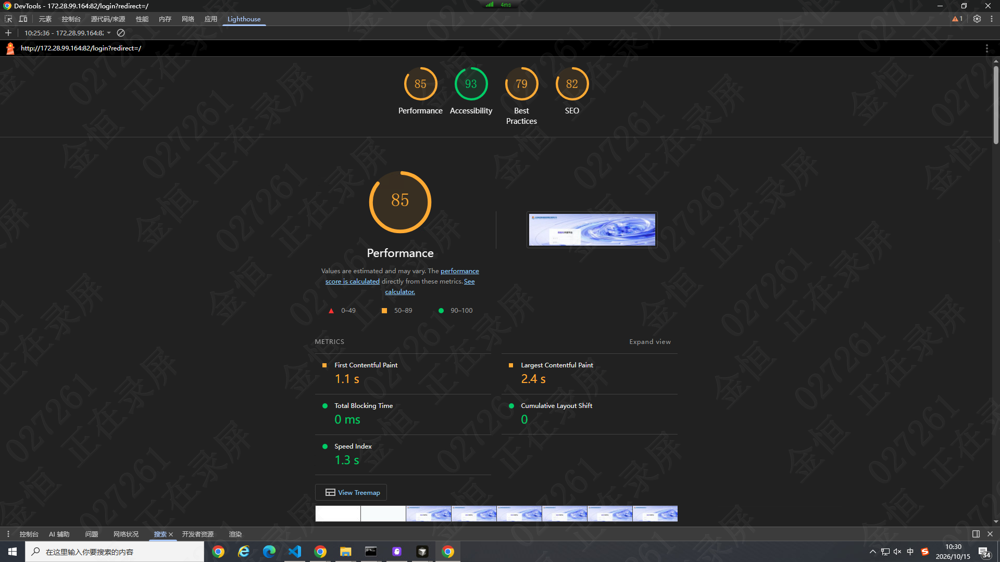
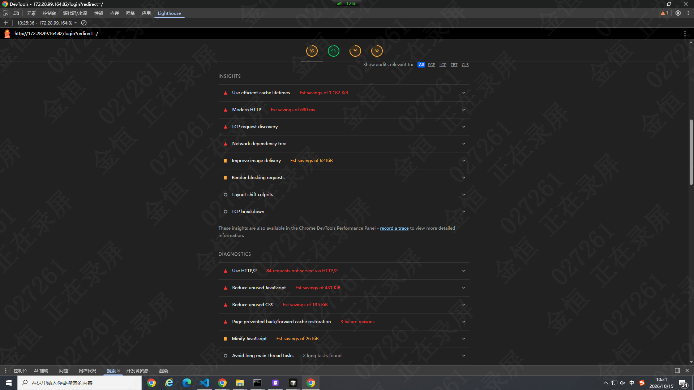
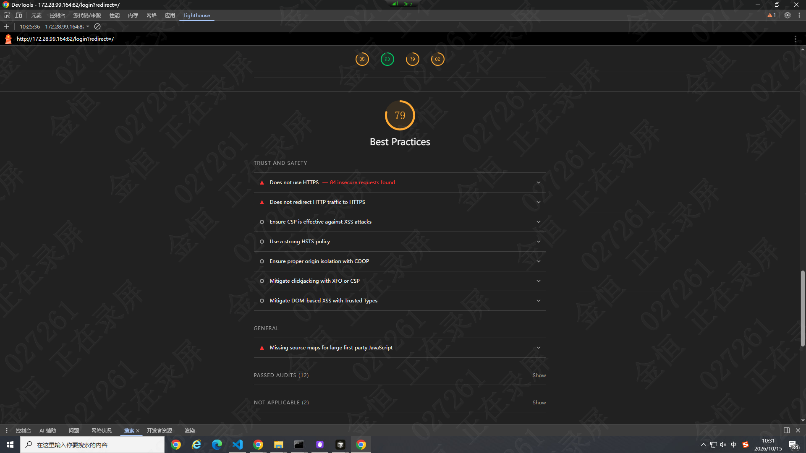
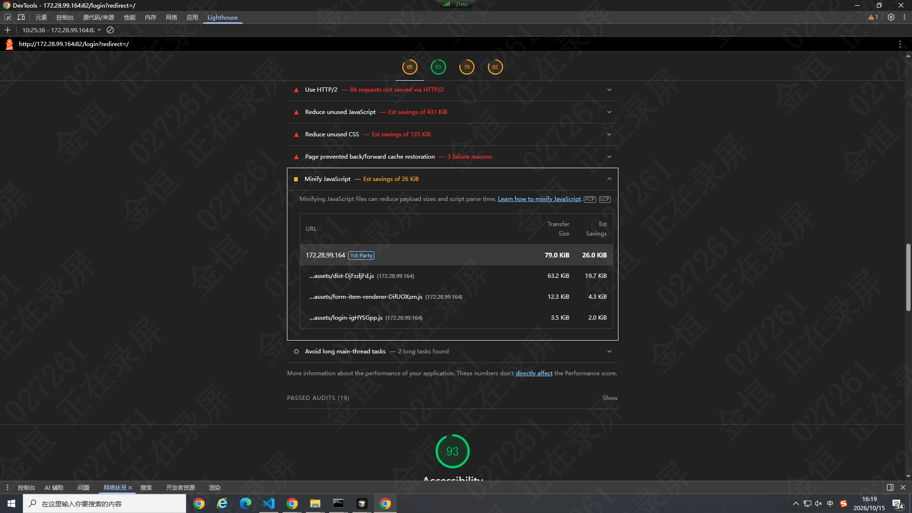

# 前端性能优化笔记（Core Web Vitals实战）
> 完整闭环：**发现问题 → 定位原因 → 制定方案 → 验证效果**，用指标+工具+数据做性能优化。

## 一、核心指标 Core Web Vitals
### 指标含义与阈值
|指标|全称|作用|良好|需改进|差|
| ---- | ---- | ---- | ---- | ---- | ---- |
|LCP|最大内容绘制|首屏主要内容渲染完成，代表首屏速度|≤2.5s|2.5‑4s|>4s|
|FCP|首次内容绘制|页面第一次渲染任意内容，衡量白屏时长|≤1.8s|1.8‑3s|>3s|
|CLS|累积布局偏移|页面元素跳动，视觉稳定性|≤0.1|0.1‑0.25|>0.25|
|INP|交互到下一次绘制|用户点击输入响应快慢，替代FID|≤200ms|200‑500ms|>500ms|
|TTFB|首字节时间|服务器响应速度，后端/网络瓶颈|≤800ms|800‑1.8s|>1.8s|

- LCP差：首屏慢；FCP差：白屏久；CLS差：页面乱跳；INP差：交互卡顿；TTFB差：后端网络拖慢整体加载。

### 两类数据来源
1. **实验室数据**：本地Lighthouse、Performance录制，适合复现、优化前后对比。
2. **RUM真实用户数据**：web‑vitals库线上上报，反映真实设备网络下性能，实验室好≠线上好。

## 二、Chrome工具：定位性能瓶颈
1. **Lighthouse**：页面体检，输出评分、改进清单。
    - 使用技巧：无痕模式、模拟移动端+弱网；重点看Opportunities改进机会、Diagnostics诊断，不要只看总分。
2. **Performance面板**：精准定位长任务、渲染、LCP时间点。
    - Main主线程：>50ms黄色长条是长任务，阻塞渲染交互；Timings标记FCP/LCP时间轴；Frames看掉帧情况。
3. **Network面板**：瀑布图分析请求优先级、阻塞关系。
    - 找到LCP对应资源，查看请求开始时间、耗时，排查关键资源被串行阻塞问题。
4. **其他工具**
    - Coverage：查看JS/CSS未使用占比，辅助做代码分割；
    - Memory：排查内存泄漏；
    - Performance insights：新版DevTools快速关联指标与资源脚本。

### 工具‑指标对应简表
|目标指标|工具|定位思路|
| ---- | ---- | ---- |
|FCP|Lighthouse+Performance+Network|阻塞JS/CSS、TTFB、关键资源优先级|
|LCP|Lighthouse+Performance+Network|确认LCP元素，看资源大小、请求时机、主线程长任务|
|CLS|Lighthouse+Performance|Layout布局频繁触发，无尺寸图片/广告/字体切换|
|INP|Performance|交互时刻主线程长任务、重排重绘开销|
|TTFB|Network+服务端|HTML等待时间，服务端/CDN问题|

## 三、分指标优化方案
### ✨优化FCP（减少白屏）
问题根源：阻塞渲染JS/CSS过大，TTFB高，关键资源加载晚。
方案：
1. 首屏关键CSS内联；非关键JS使用defer/延迟加载；关键资源preload预加载。
2. 提升TTFB，CDN、服务端缓存。
3. 代码分割，路由懒加载，首屏只加载必要代码，第三方脚本延迟执行。

### ✨优化LCP（首屏主要内容）
常见LCP元素：大图、视频、大文本。
方案：
1. 图片：WebP/AVIF格式、适配尺寸，`fetchpriority="high"`提升优先级，CDN+srcset响应式。
2. 资源预加载preload，缓存策略。
3. 字体优化：`font‑display:swap/optional`，预加载标题字体。
4. 减少LCP前主线程长任务，避免JS阻塞资源请求与渲染。

### ✨优化CLS（解决页面跳动）
根源：图片广告无占位，动态插入DOM，字体切换重排。
方案：
1. 图片视频设置宽高或`aspect‑ratio`；广告、iframe预留占位容器。
2. 避免首屏上方动态插入内容。
3. font‑display属性，预加载字体，减少字体切换布局跳动。

### ✨优化INP交互卡顿
根源：主线程被长任务占用，频繁重排重绘。
方案：
1. 拆分长任务：setTimeout、requestIdleCallback让出主线程；重计算放到Web Worker。
2. 高频事件做防抖节流；长列表使用虚拟列表。
3. 避免循环中交替读取、修改DOM样式，合并DOM操作减少reflow。

### ✨优化TTFB首字节
1. 后端优化接口、数据库，增加缓存，减少首屏依赖接口。
2. HTML、静态资源部署CDN边缘节点。
3. SSR场景优化服务端渲染链路。
> TTFB改善直接利好FCP、LCP指标。

## 四、验证 & 线上监控
1. **优化对比**：相同环境，多次测试取中位数，记录优化前后指标数据。
2. **web‑vitals线上埋点**
```js
import { getCLS, getINP, getFCP, getLCP, getTTFB } from 'web‑vitals';
function report(metric) {
  console.log(metric.name, metric.value, metric.rating);
  // sendToAnalytics(metric)上报监控平台
}
getCLS(report);
getINP(report);
getFCP(report);
getLCP(report);
getTTFB(report);
```
可根据`metric.rating`（good/needs‑improvement/poor）做告警大盘统计。

## 五、面试回答思路
> 问题：你怎么做前端性能优化？
1. **指标**：以Core Web Vitals（LCP/FCP/CLS/INP）+TTFB判断瓶颈，区分首屏慢、跳动、交互卡顿。
2. **工具**：Lighthouse整体体检；Performance定位长任务；Network分析请求链路。
3. **方案**：按指标定向解决，不是堆方案；如LCP慢就处理LCP图片资源、优先级；CLS做占位等。
4. **验证**：优化前后对比，线上RUM持续监控，拿数据说话。
> 补充真实业务案例：例如LCP从4.2s优化到2.1s的实操过程。

## 六、核心总结
1. 先读懂指标，明确用户体感；
2. 使用工具定位真实瓶颈，拒绝盲调；
3. 针对指标做定向优化；
4. 性能是持续迭代工作，必须做优化前后对比+线上持续监控闭环。

## 七、实战






1. 首页所有图片换成webp格式并压缩，减少图片大小(80%)，并对LCP图片设置fetchpriority="high"，提高加载的优先级。
2. 开启http2多路复用（需要运维设置，只支持https）
3. 设置cache-control缓存策略，减少重复请求（运维设置，ETag还是需要请求服务器比对文件hash）（max-age需要配合打包时使用Content-hash）。
4. vite打包显示的设置minify: 'oxc'（ 客户端构建默认为'oxc'，`rollupOptions.input`（脱离 html 入口），Vite 会把这次构建判定为【库类构建场景】，minify 默认变成 `false`！）
5. 拆分代码
6. 字体优化 - 使用字体子集(fontsubset)拆分首屏使用的字体，剩余fallback字体 prefetch加载
    - 添加prebuild脚本统计首屏需要的汉字，使用subset-font拆分字体包
    - 用js动态添加link prefetch加载剩余字体
7. 优化依赖导入 - 禁止深入包的内部导入，从包的入口文件导入方法 '@jh4j/common-core/src/xxx' 改为 '@jh4j/common-core'。并添加prebuild脚本限制只能导入入口文件